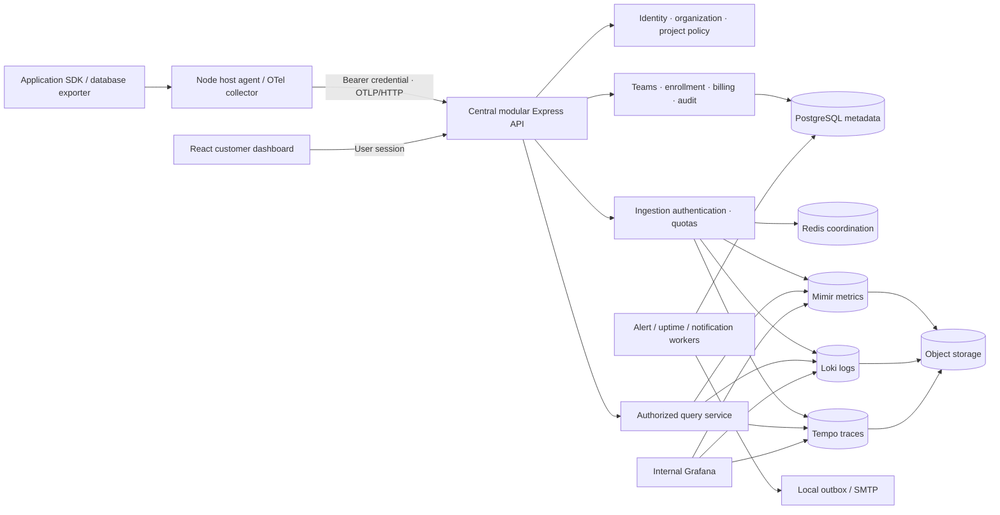
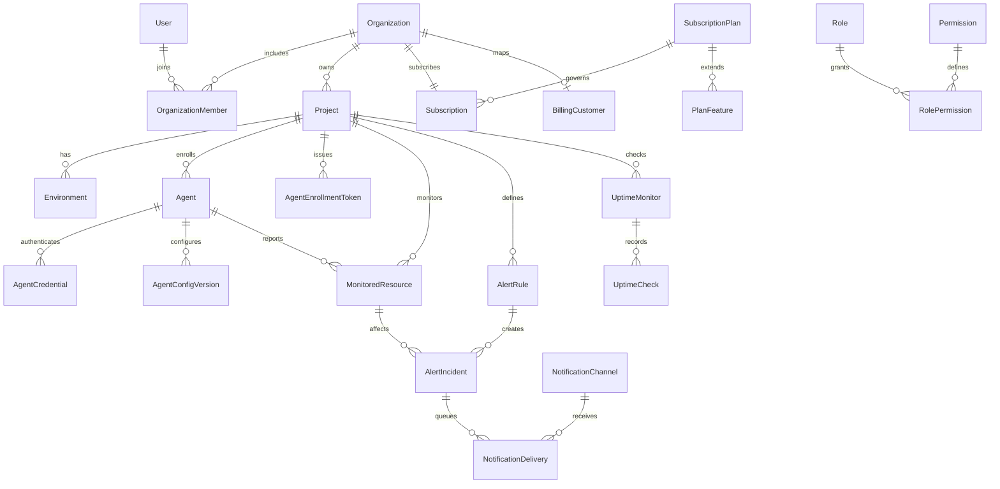

# Product and architecture

Pulse gives pilot customers one place to inspect infrastructure health, application metrics, logs, traces, uptime, alerts, access, and usage. The pilot prioritizes a simple centralized deployment for 5–10 organizations. Customers keep their existing infrastructure and send telemetry outbound.

## System boundaries



One codebase and one API process initially, with clear modules. Infrastructure backends are off-the-shelf services. Redis coordinates ingestion/query limits and a worker lease in connected mode. No Kafka, service mesh, Kubernetes, custom telemetry protocol, MFA service, or extra policy platform is required to run the pilot.

The API currently starts background workers in the same process. Extract worker startup behind a dedicated process and improve distributed job leases before increasing replica counts. Telemetry and query backends have independent capacity boundaries even though Compose runs them on one host.

The local S3 service is RustFS 1.0.1. The initially considered MinIO images were unavailable during verification; RustFS uses the same S3 contract and environment-managed credentials. See [official RustFS container instructions](https://github.com/rustfs/rustfs#docker-quick-start-option-2) and [credential configuration](https://docs.rustfs.com/en/operations/credentials).

## Decisions

| ADR | Decision                                                         | Reason and consequence                                                                                                                                                                                             |
| --- | ---------------------------------------------------------------- | ------------------------------------------------------------------------------------------------------------------------------------------------------------------------------------------------------------------ |
| 001 | Modular Express, JavaScript                                      | Straightforward code and centralized route/service/repository patterns; no framework decorators.                                                                                                                   |
| 002 | React + Vite + Tailwind + reusable Radix/shadcn-style components | Custom customer UI, TanStack Query for server state, Recharts for metrics. Shared controls live in one module.                                                                                                     |
| 003 | PostgreSQL via Prisma for metadata                               | Normalized records and explicit migrations. High-volume telemetry lives elsewhere.                                                                                                                                 |
| 004 | Mimir monolith for shared metrics                                | Prometheus alone lacks an organization authentication/tenancy boundary. A Prometheus-per-project deployment is possible, but increases instance management. Mimir's project storage tenants align with Loki/Tempo. |
| 005 | Derive backend tenant from credential                            | Backend injects `orgId_projectId`; client tenant headers are ignored. Queries iterate only permitted projects.                                                                                                     |
| 006 | Root .env for service credentials                                | No duplicate config or frontend secrets. User passwords and agent keys are stored as hashes, not plaintext environment variables.                                                                                  |
| 007 | Explicit demo adapter                                            | Easy startup without infrastructure. JSON metadata is a local convenience; never horizontally scale the demo adapter.                                                                                              |
| 008 | Mock payment provider, local email by default                    | Fully testable workflows without pretending a payment occurred or sending external messages.                                                                                                                       |

Mimir tenant headers are storage routing, not authentication. Loki specifically delegates authentication to an upstream gateway; Pulse supplies that role. See [Loki authentication](https://grafana.com/docs/loki/latest/operations/authentication/) and [Mimir OpenTelemetry ingestion](https://grafana.com/docs/mimir/latest/configure/configure-otel-collector/).

## Tenant and authorization model

Users can belong to organizations. Each organization has projects, environments, agents, resources, one subscription, and notification channels. Owner/admin/editor/viewer roles are centrally checked. Members can be restricted to project IDs; an empty assignment means all projects. Owners manage subscriptions and administrator memberships; admins manage team/settings/keys; editors manage monitoring; viewers read monitoring only. A restricted administrator cannot grant project access beyond their own scope.

Storage tenancy is per organization **and project**. Every ingestion credential is bound to one project and every query derives permitted project IDs from the authenticated membership. Passing a different organization, project, resource ID, or `X-Scope-OrgID` never grants access. Agent and API tokens are random, shown once, and persisted as SHA-256 hashes. User passwords use salted scrypt. Sessions are signed, expire after 12 hours, and require current membership on every request.

JSON OTLP requests remove selected sensitive attributes. Protobuf relies on source redaction and backend validation; do not claim universal secret detection. The supplied collector deletes authorization/cookie and database query text fields. Arbitrary log bodies can still contain application-provided secrets and must be sanitized at the source.

Queries use fixed metric presets, escaped log search, bounded time ranges (up to 24 hours), and result caps. No customer is given backend storage URLs or credentials. Local Compose maps storage service ports to loopback for developer diagnostics; remove those mappings on hosted systems. Uptime DNS results must all be public, the connection pins the resolved address, and redirects are not followed.

## Metadata ER diagram



The executable schema is `backend/prisma/schema.prisma`. Tenant/project composite foreign keys protect project-owned entities. Organization metadata tables also receive explicit organization foreign keys in SQL. Unique constraints cover membership, project slugs, environment names, token hashes, monthly usage, and payment event IDs. All models have timestamps. Resource inventory is soft deleted. Historical check/delivery cleanup runs in the worker; audit and billing retention require a deployment policy. Role/permission tables and plan feature extensions are reserved for configurable roles/enterprise entitlements; current four roles and core plan limits are intentionally centralized in services.

## Customer experience / wireframes

The desktop shell has a persistent workspace sidebar, organization switch, breadcrumb/search bar, project/environment filters, and responsive content. Mobile navigation uses a drawer.

```
Sidebar          Workspace / Overview                 Search · Alerts
                 Project · Environment                Demo indicator
                 Workspace overview                   Range · Connect source
                 Health summary
                 [Servers] [Containers] [Throughput] [Incidents]
                 [CPU timeline]          [Memory timeline]
                 [Server health table]   [Recent incidents]
                 [Application performance summary]
```

Resource pages reuse summary cards and sortable tables with detail dialogs. Logs use a searchable event list; traces use an operation table and detail view. Settings separates organization, projects, keys, channels, and audit. No service credentials are exposed through the customer UI.

## Deployment models

The included Compose stack runs all services centrally. A customer can run the same connected stack locally for a self-managed deployment. Endpoints are configured in `.env`. A cloud-managed control plane paired with isolated customer data planes needs a per-installation routing/identity contract, connectivity design, licensing, and tested upgrade coordination; that hybrid product is specified as a later phase, not silently represented as implemented. Fully offline licensing and managed Kubernetes/Helm installations are later enterprise work.
