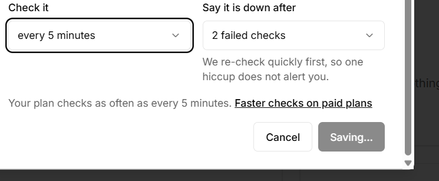

# YuktiOps — Bug Reports & Feature Specifications

> **Document Purpose:** Structured issue tracker and feature specification formatted for automated AI coding agents (e.g., Cursor, Claude Code, GitHub Copilot Workspace).

---

## 🔴 Bug Reports

### [BUG-01] Docker Agent Image Pull Denied (`ghcr.io/yuktiops/agent:latest`)
* **Severity:** High / Blocker
* **Component:** Infrastructure / Docker Agent
* **Description:** Running the agent installation command fails because the Docker daemon is denied access to pull `ghcr.io/yuktiops/agent:latest` from the GitHub Container Registry.
* **Command Executed:**
  ```powershell
  docker run -d --name yuktiops-agent --restart unless-stopped `
    --pid host --network host `
    -v /:/host:ro -e HOST_ROOT=/host `
    -e YUKTIOPS_API_KEY=YOUR_API_KEY `
    -e YUKTIOPS_API_URL=http://localhost:4000 `
    -v yuktiops-agent:/var/lib/yuktiops `
    -v /var/run/docker.sock:/var/run/docker.sock:ro `
    ghcr.io/yuktiops/agent:latest
  ```
* **Error Output:**
  ```text
  Unable to find image 'ghcr.io/yuktiops/agent:latest' locally
  docker: Error response from daemon: error from registry: denied
  denied
  ```
* **Expected Resolution:**
  * Verify whether the GHCR package visibility is set to private instead of public, or provide local build/run instructions (`docker build` / `docker-compose`) if the image is not publicly hosted yet.
  * Update the UI onboarding command accordingly.

---

### [BUG-02] Service Deletion Fails
* **Severity:** High
* **Component:** Services Management (Backend / Frontend)
* **Description:** Attempting to delete an existing service fails in the UI.
* **Error Message:** `"The service could not complete this request."`
* **Expected Resolution:**
  * Inspect the `DELETE` endpoint for services in the backend API.
  * Check for foreign key constraint violations (e.g., related logs, metrics, or monitors preventing cascade deletion) or Prisma query errors.
  * Ensure proper error handling and cascade deletion in the database schema/service layer.

---

### [BUG-03] API Unavailable When Editing a Service
* **Severity:** High
* **Component:** Services Management (Backend / Frontend)
* **Description:** Attempting to edit/update an existing service triggers an API unavailability error.
* **Error Message:** `"The API is unavailable."`
* **Expected Resolution:**
  * Check the `PUT`/`PATCH` endpoint route, request payload validation, and network request URL on the edit service form.
  * Ensure the endpoint is properly registered and handling incoming updates without crashing or timing out.

---

### [BUG-04] Servers Page Fails to Load
* **Severity:** High
* **Component:** Servers Dashboard (Frontend / Backend)
* **Description:** Navigating to the Servers page results in a load failure error state.
* **Error Message:** `"We couldn't load your servers"`
* **Expected Resolution:**
  * Debug the API endpoint responsible for fetching server lists (check for serialization issues like Prisma `Decimal` or `BigInt` fields, auth middleware failures, or unhandled exceptions).

---

### [BUG-05] UI Freezes in "Saving" State
* **Severity:** Medium
* **Component:** Frontend UI / State Management
* **Reference Screenshot:** 
* **Description:** When submitting/saving a form, the UI button/modal gets stuck indefinitely in a `"Saving..."` loading state.
* **Expected Resolution:**
  * Ensure `try / catch / finally` blocks properly reset loading states (`setIsSaving(false)`) even when API requests fail, time out, or return unexpected status codes.

---

### [BUG-06] OpenTelemetry (OTel) Key Creation Error
* **Severity:** Medium
* **Component:** OTel Integration / API Key Generation
* **Description:** Generating a new API key on the OpenTelemetry setup page displays an error banner despite the setup instructions remaining visible.
* **Error Message:** `"The service could not complete this request. The setup steps below still work."`
* **Expected Resolution:**
  * Debug the OTel key generation endpoint in the backend. Verify database insertion, permissions, and response formatting.

---

## 🟢 Feature Requests & Improvements

### [FEAT-01] Separate Run Commands & Terminals by Service
* **Component:** Developer Experience / CLI / Documentation / Scripts
* **Requirements:**
  * Separate execution commands for individual services: **Frontend**, **Backend**, and **Worker**.
  * Configure development workflows/scripts so each service (**Frontend**, **Backend**, and **Worker**) runs in its own dedicated terminal process rather than a single combined output stream.

---

### [FEAT-02] Add Local Testing Instructions per Service in UI
* **Component:** Frontend UI / Onboarding
* **Requirements:**
  * For each service type displayed in the UI (e.g., Frontend, Backend, Worker, API, Server), include a clear section/guide explaining how to test and verify the integration locally.

---

### [FEAT-03] Add "Paste cURL" Option in Website/API Monitoring
* **Component:** API Monitoring (Frontend)
* **Requirements:**
  * Add an import/paste input field in the Website/API Monitoring creation form that accepts a raw `curl` command.
  * Automatically parse the `curl` string to populate the HTTP method, URL, headers, query parameters, and request body fields.

---

### [FEAT-04] Add Analytics & Monitoring Graphs to Overview Page
* **Component:** Overview Dashboard (Frontend)
* **Requirements:**
  * Enhance the main Overview dashboard page with visual charts/graphs (e.g., uptime trends, API response latency, server CPU/memory usage, or error rates over time).